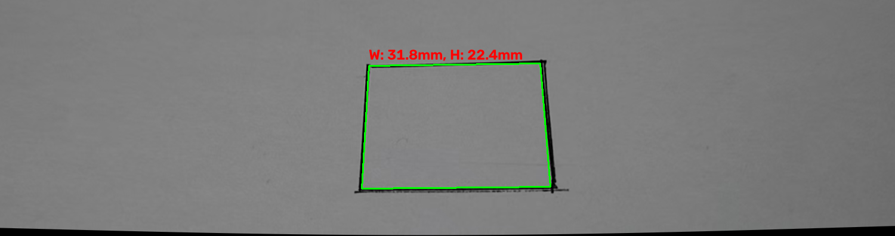
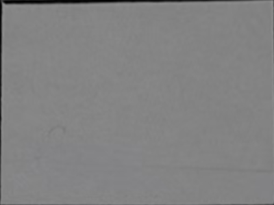

# 基于单目相机的零件尺寸测量与姿态矫正系统

基于 Python 与 OpenCV 实现的工业视觉基础项目，实现了从相机标定、去畸变到物理尺寸测量的全流程闭环。

## 效果展示

**1. 工业零件测量结果：**

**2. 透视变换拉正效果：**

## 技术栈

- **语言**：Python
- **核心库**：OpenCV, NumPy

## 核心实现逻辑

1. **相机标定**：基于张正友标定法，使用棋盘格计算相机内参矩阵与畸变系数。
2. **去畸变**：利用获取的内参对原始图像进行矫正，消除镜头边缘畸变。
3. **边缘提取与拟合**：采用 Canny 边缘检测与自适应阈值，通过多边形拟合（approxPolyDP）自动提取目标四个角点。
4. **透视变换**：计算单应性矩阵，将倾斜目标强行拉正至标准正视图。
5. **尺寸测量**：结合标定焦距、相机工作距离，利用单目测距公式完成像素到毫米级的物理尺寸换算。
